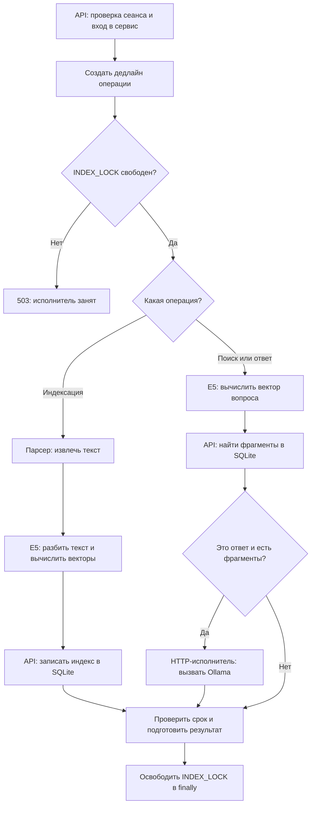
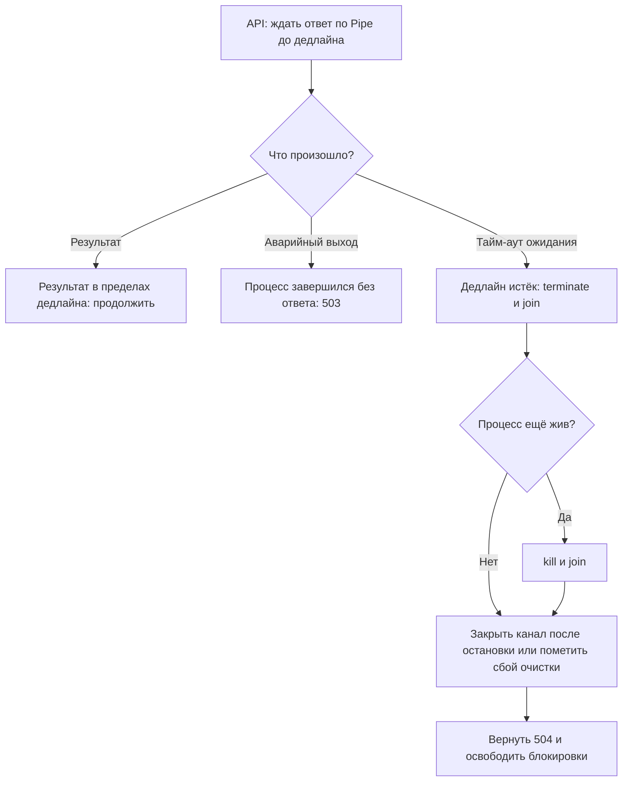

# Дедлайн и дочерние процессы

У каждой тяжёлой операции есть один общий срок. При переходе от поиска к
генерации время не обнуляется. API выполняет проверку прав, читает и пишет SQLite
и управляет исполнителями. Исполнители выполняют парсинг, расчёт векторов и HTTP-вызов. Дедлайн отсчитывается с момента входа в сервис; ожидание потока API,
аутентификация FastAPI и отдельная загрузка файла в этот срок не входят.

## Как проходит запрос

`Deadline` хранит момент окончания по монотонным часам, чтобы не зависеть от возможных изменений системного времени. Необходимо точно измерять интервалы для определения дедлайна.

## Какие процессы запускаются

| Исполнитель | Использование | Что возвращает API |
|---|---|---|
| `PARSER`: `_parse_job()` | Индексация TXT, DOCX или PDF | Извлечённый текст и координаты источника. |
| `EMBEDDINGS`: `_embedding_job()` | Индексация, самостоятельный поиск и поиск внутри `/ask` | Для индексации — фрагменты и векторы; для поиска — вектор вопроса. В обоих случаях возвращает отпечаток модели. |
| `HTTP_WORKER`: `_http_job()` | Генерация ответа при найденном контексте | Результат вызова локального `/api/chat`. Qwen работает в сервисе Ollama, который запускается отдельно. |

`ProcessWorker` создаёт исполнителя по первому заданию через spawn, передаёт
аргументы и срок через Pipe и следит за ответом. У каждого исполнителя
свой _guard: одновременно по одному каналу идёт только одно задание.
INDEX_LOCK защищает операцию целиком и остаётся захваченным, когда
/ask переходит от E5 к HTTP. После успешного задания
процесс переиспользуется; E5 держит загруженную модель в своём процессе.
При штатной остановке API lifespan закрывает исполнителей.

## Обработка тайм-аута

Схема показывает тайм-аут ожидания дочернего процесса. Если процесс ответил
своей ошибкой до срока, API обрабатывает её отдельно. Если завершение процесса
не подтверждено, новый исполнитель поверх старого не запускается. При сбое
индексации API пытается отдельной короткой транзакцией записать `failed`, если
документ уже был в `processing`.

Остановка HTTP-исполнителя не подтверждает остановку Qwen. После тайм-аута
отправленного задания повторная генерация может вернуть 503 о неподтверждённом
состоянии Ollama.
